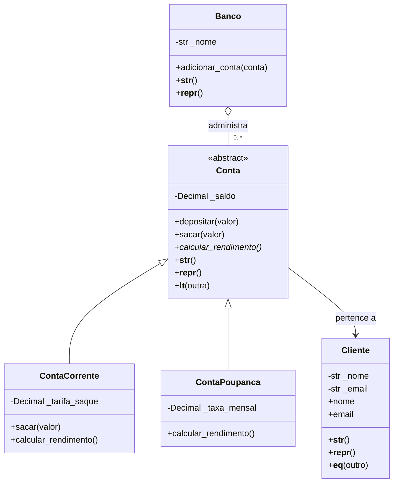

# Sprint 6 — Sistema Bancário com POO

Projeto didático em Python para demonstrar classes, objetos, encapsulamento, herança, polimorfismo, classe abstrata e métodos especiais.

## Requisitos

- Python 3.10 ou superior.
- Nenhuma biblioteca externa é necessária.

## Como executar

```bash
python sistema_bancario.py
```

O programa cria 5 clientes e 10 contas, demonstra o polimorfismo, ordena as contas por saldo e testa entradas inválidas com `try/except/else/finally`.

## Modelagem



## Decisões de modelagem

- **`Conta` é abstrata:** define o contrato `calcular_rendimento()` sem permitir que uma conta genérica seja instanciada.
- **Herança:** `ContaCorrente` e `ContaPoupanca` são tipos de `Conta`, reutilizam sua lógica e chamam `super().__init__()`.
- **Polimorfismo:** ambas implementam `calcular_rendimento()`. O laço chama o mesmo método em objetos diferentes; a conta corrente retorna zero e a poupança calcula o rendimento estimado.
- **Composição/agregação:** `Banco` mantém uma coleção de contas, e cada `Conta` referencia um `Cliente`. Isso evita duplicar os dados do cliente em cada operação.
- **`Decimal`:** valores monetários são representados com `Decimal` para evitar os erros comuns de precisão binária de `float`.

## Encapsulamento e validações

- `Cliente.nome`: exige texto não vazio.
- `Cliente.email`: exige uma estrutura básica com `@` e domínio contendo ponto.
- `Conta.saldo`: expõe o saldo por uma propriedade somente de leitura. Depósitos e saques são realizados por métodos que validam o valor.
- `ContaCorrente.tarifa_saque`: aceita somente valores finitos não negativos.
- `ContaPoupanca.taxa_mensal`: aceita taxas entre `0` e `1`.
- `Banco.nome`: exige texto não vazio.
- `Banco.adicionar_conta()`: verifica o tipo da conta e impede números duplicados.

Os construtores passam pelos setters ou pelas validações correspondentes para impedir estados inválidos.

## Métodos especiais

- `__str__`: representação legível.
- `__repr__`: representação útil para depuração.
- `__eq__` em `Cliente`: considera clientes iguais quando têm o mesmo e-mail.
- `__lt__` em `Conta`: permite ordenar contas pelo saldo, por exemplo com `sorted(contas)`.

## Exemplo de uso

```python
from sistema_bancario import Cliente, ContaPoupanca

cliente = Cliente("Maria", "maria@example.com")
conta = ContaPoupanca("CP-100", cliente, 1000, "0.005")

conta.depositar(250)
print(conta)
print(f"Rendimento estimado: R$ {conta.calcular_rendimento():.2f}")
```

## Testes de exceções

O programa demonstra erros como e-mail inválido, depósito negativo, saque acima do saldo, tarifa negativa e tentativa de cadastrar uma conta duplicada. As exceções são capturadas e apresentadas sem encerrar o programa.

## Publicação no GitHub

1. Crie um repositório chamado `sprint-06-poo`.
2. Adicione `sistema_bancario.py` e `README.md`.
3. Faça o commit e envie para o GitHub:

```bash
git init
git add sistema_bancario.py README.md
git commit -m "Entrega Sprint 6: sistema bancário com POO"
git branch -M main
git remote add origin https://github.com/SEU-USUARIO/sprint-06-poo.git
git push -u origin main
```

Substitua `SEU-USUARIO` pelo seu usuário do GitHub e deixe o repositório público, se a instituição exigir acesso público.
